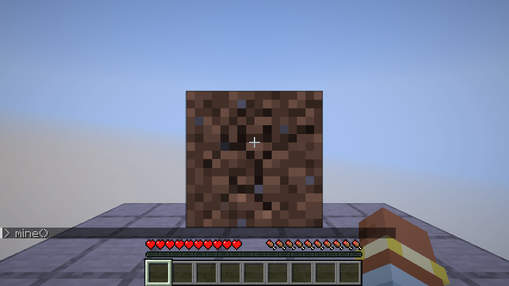
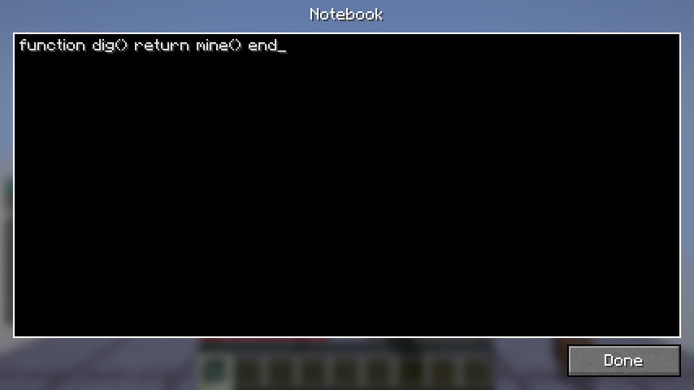
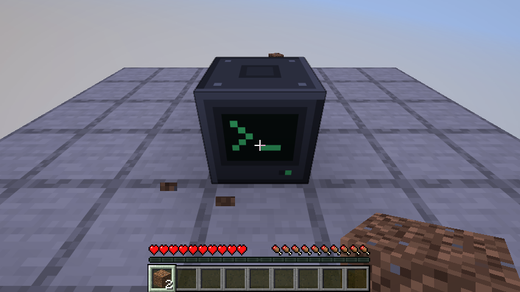
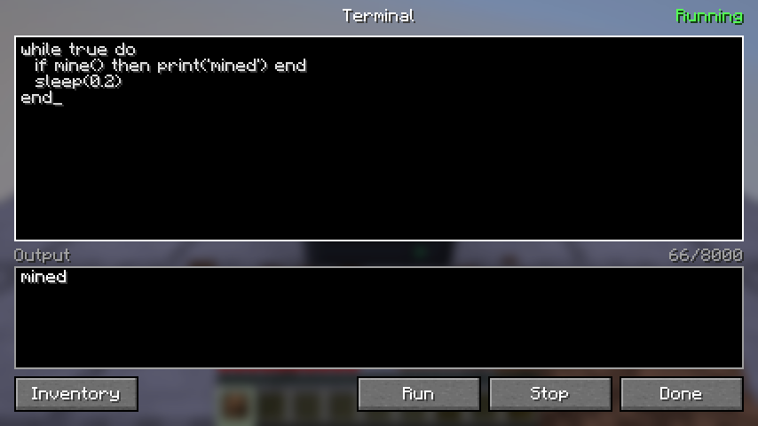
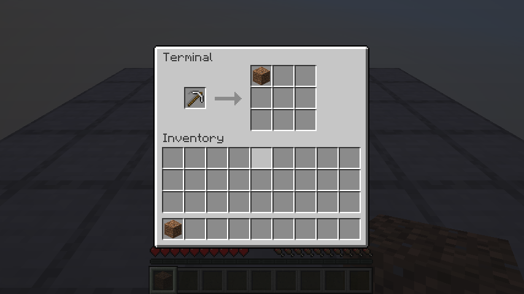
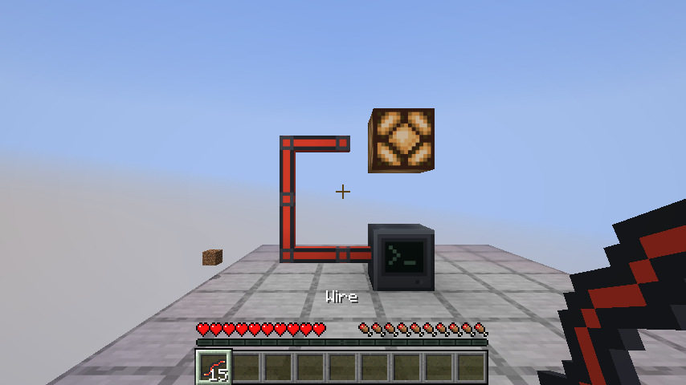

# Minecod

Мод для Minecraft (Fabric), в котором блоки нельзя ломать руками. Их ломает код на Lua: ты пишешь его прямо в чате, хранишь свои функции в блокноте или сохраняешь программу в блок-терминал, который выполняет её сам.



Сейчас работают запуск кода из чата, запрет на добычу руками, блокнот, терминал с инвентарём и провода, которыми терминалы связываются друг с другом и с механизмами. Прогрессии пока нет, идеи для неё — в конце.

## Запуск

Нужен JDK 25. Версии игры и библиотек лежат в `gradle.properties` (сейчас Minecraft 26.3).

```bash
./gradlew runClient
```

Собрать jar для установки в обычный лаунчер:

```bash
./gradlew build
```

Файл появится в `build/libs/`. Рядом с ним в папке `mods` должен лежать Fabric API. Мод нужен и на клиенте, и на сервере.

## Как играть

Создай мир в режиме выживания и ударь по дереву: ничего не произойдёт. Теперь посмотри на блок и напиши в чат:

```
/run mine()
```

То же самое короче, через префикс `>`:

```
> mine()
```

Блок ломается столько же, сколько ломался бы рукой с тем же инструментом, и всё это время на него нужно смотреть.

| Функция | Что делает |
| --- | --- |
| `mine()` | Ломает блок, на который ты смотришь. Возвращает `true, id` или `false, причина` |
| `place()` | Ставит блок из руки к блоку, на который ты смотришь. Возвращает `true, id` или `false, причина` |
| `use()` | Правый клик: по блоку, на который ты смотришь, или предметом в руке. Возвращает `true` или `false, причина` |
| `inspect()` | Возвращает `id, x, y, z` блока, на который ты смотришь, или `nil` |
| `held()` | Возвращает `id, количество` предмета в руке или `nil` |
| `select(слот или id)` | Переключает хотбар на слот от 1 до 9 или на слот с этим предметом. Возвращает `true` или `false` |
| `count([id])` | Возвращает, сколько у тебя предметов: всех или только с этим `id` |
| `pos()` | Возвращает твои координаты `x, y, z` |
| `sleep(секунды)` | Ждёт |
| `print(...)` | Пишет в чат |
| `help()` | Показывает этот список в игре |

Ещё доступен обычный Lua 5.2: `string`, `table`, `math`, `bit32`.

```
> for i = 1, 3 do mine() end
> while inspect() == "minecraft:oak_log" do mine() end
> 2 + 2
> wood = 0
> if mine() then wood = wood + 1 end return wood
> if select("minecraft:oak_sapling") then place() end
```

- Выражение без `return` тоже вернёт результат, как в консоли.
- Переменные живут, пока ты не вышел из мира.
- У игрока одновременно выполняется один скрипт. `/halt` его останавливает.
- В творческом режиме руки работают как обычно.
- `/gamerule minecod:hand_mining true` отключает запрет для всего мира.

## Блокнот

Код в чате ограничен 256 символами и нигде не хранится. Блокнот хранит то, что ты не хочешь набирать каждый раз, обычно функции.



Крафтится из книги и редстоуна. Правый клик с блокнотом в руке открывает редактор, закрытие сохраняет текст.

Пока блокнот лежит в инвентаре, его код выполняется перед твоим кодом из чата: один раз и заново после каждой правки. Напиши в нём:

```lua
function tunnel(length)
  for i = 1, length do
    if not mine() then return i - 1 end
  end
  return length
end
```

И вызывай из чата:

```
> tunnel(10)
```

- Можно носить несколько блокнотов, они выполняются в порядке слотов инвентаря.
- Ошибка в блокноте останавливает запуск. Её сообщение начинается с `notebook:` и номера строки.

## Терминал

Блок, который хранит программу и выполняет её сам, без игрока рядом, пока загружен его чанк.



Крафтится как раздатчик, только вместо лука стеклянная панель: 7 булыжника, панель в центре, редстоун снизу. Правый клик открывает редактор.



- **Запустить** сохраняет программу и запускает её с первой строки. **Остановить** останавливает её и выключает редстоун-сигнал.
- Закрытие экрана сохраняет текст и не трогает работающую программу.
- Добытый терминал уносит программу с собой в предмете и получает её обратно, когда его ставят.
- Сторона с экраном — перед. Терминал добывает блок, который стоит перед экраном.
- Кнопка **Инвентарь** открывает слот для инструмента и 9 слотов хранилища.
- Добывает он инструментом из слота, с той же скоростью, что и игрок. Без подходящего инструмента он работает как голая рука: камень и руду ломает медленно и без дропа.
- Добытое складывается в хранилище, а что не влезло — падает на землю. Зачарования на инструменте работают, инструмент изнашивается.
- Воронки забирают предметы из хранилища и кладут в него, но инструмент не трогают.
- Сигнал он передаёт по проводам, о них ниже. Редстоун тоже работает, но хуже.
- Значок `>_` на экране тусклый, когда терминал стоит, зелёный, когда работает, и красный после ошибки.

| Функция | Что делает |
| --- | --- |
| `mine()` | Ломает блок перед экраном. Возвращает `true, id` или `false, причина` |
| `place([id])` | Ставит перед экраном блок из хранилища: с этим `id` или первый попавшийся. Возвращает `true, id` или `false, причина` |
| `inspect()` | Возвращает `id` блока перед экраном или `nil`, если там воздух |
| `tool()` | Возвращает `id` инструмента и сколько блоков он ещё выдержит, или `nil` |
| `count([id])` | Возвращает, сколько предметов в хранилище: всех или только с этим `id` |
| `push()` | Перекладывает хранилище в сундуки и другие контейнеры вплотную к терминалу. Возвращает, сколько переложил |
| `emit(число)` | Выдаёт сигнал в провода и назад редстоуном. `true` и `false` означают 15 и 0 |
| `signal()` | Возвращает самый сильный сигнал, который выдают в его провода другие терминалы |
| `redstone()` | Возвращает силу входящего редстоун-сигнала, от 0 до 15. Занимает целый тик |
| `pos()` | Возвращает координаты терминала `x, y, z` |
| `sleep(секунды)` | Ждёт |
| `print(...)` | Пишет в поле «Вывод» на экране терминала |
| `help()` | Печатает этот список |



Добывать всё, что появляется перед терминалом, и складывать в сундук рядом. Так собирается, например, генератор булыжника:

```lua
while true do
  if inspect() then mine() end
  if count() >= 16 then push() end
  sleep(0.5)
end
```

Зажигать лампу на другом конце провода, пока перед терминалом что-то стоит:

```lua
while true do
  emit(inspect() ~= nil)
  sleep(0.1)
end
```

Ферма дерева: терминал сажает саженец из хранилища, ждёт, пока вырастет ствол, и срубает нижнее бревно. Под блоком перед экраном должна быть земля, в слоте инструмента пригодится топор, а саженцы нужно подкладывать в хранилище руками или воронкой:

```lua
while true do
  if inspect() == nil then
    place("minecraft:oak_sapling")
  elseif inspect() == "minecraft:oak_log" then
    mine()
  end
  sleep(1)
end
```

### Провода



Провод крафтится из трёх редстоуна в ряд, выходит 6 штук. Это кабель: он идёт в любую сторону, в том числе вверх и по воздуху, и сам соединяется с соседними проводами и с терминалами.

- Все соприкасающиеся провода образуют одну сеть. Сигнал в ней равен самому сильному из тех, что выдают подключённые терминалы.
- К терминалу провод подключается с любой стороны, кроме экрана.
- Сигнал не слабеет с расстоянием и приходит сразу.
- Между терминалами провод передаёт любое число, а не только 0–15: `emit(1000)` на одном конце даст `signal() == 1000` на другом.
- Механизмы вплотную к проводу (лампы, поршни, двери) получают этот сигнал как редстоун, от 0 до 15.
- Свой собственный сигнал терминал через `signal()` не слышит.
- Провода не читают редстоун: рычаг должен стоять у терминала, а тот уже передаст сигнал в провод.
- Поршни провода не двигают.

Редстоун остаётся запасным вариантом, и он слабее по всем пунктам:

| | Провод | Редстоун |
| --- | --- | --- |
| Значения | любое число | от 0 до 15 |
| Расстояние | любое | 15 блоков, дальше повторители |
| Чтение из программы | почти бесплатно | целый тик на каждый `redstone()` |
| Куда подключается | к любой стороне, кроме экрана | выход только сзади |

Один терминал считает добытые блоки, другой показывает счёт. Первый:

```lua
local mined = 0
while true do
  if mine() then
    mined = mined + 1
    emit(mined)
  end
  sleep(0.5)
end
```

Второй, на другом конце провода:

```lua
local last = 0
while true do
  local now = signal()
  if now ~= last then
    print("mined: " .. now)
    last = now
  end
  sleep(0.2)
end
```

## Как это устроено

```
src/main/java/io/github/meyervlad/minecod/
  Minecod.java        точка входа: команды, события, префикс в чате
  HandMining.java     запрет ломать руками
  Messages.java       как мод пишет в чат
  Programs.java       текст программы как свойство предмета
  command/            /run и /halt
  session/            Lua-состояние и текущий скрипт каждого игрока
  notebook/           блокнот: предмет и его сетевые пакеты
  api/                функции Lua для кода из чата и общая основа для функций
  terminal/           блок-терминал: блок, его состояние, его функции Lua, сетевые пакеты
  wire/               провод и расчёт сигнала в сети проводов
  client/             экраны редакторов и инвентаря; только этот пакет трогает клиентский код игры
  script/             запуск Lua, от Minecraft не зависит
```

**Скрипт не может повесить игру.** Каждый скрипт работает в своём потоке, но никогда не одновременно с сервером: они передают управление друг другу, как эстафету. Раз в тик сервер отдаёт управление скрипту и ждёт, пока тот его вернёт. Скрипт возвращает управление, когда потратил 20 000 инструкций, попросил что-то у игры или закончился. Поэтому `while true do end` просто ест свой бюджет каждый тик, пока его не остановят.

**Мир трогает только серверный поток.** Функция из Lua сама ничего не ломает. Она отдаёт серверу задачу (`Task`), а сервер вызывает её раз в тик, пока та не вернёт результат. Так `mine()` длится много тиков, а скрипт всё это время стоит на паузе.

**Сеть проводов нигде не хранится.** Когда терминал меняет сигнал или провод ставят и убирают, мод заново обходит соприкасающиеся провода, находит подключённые терминалы и выставляет всем проводам сети одну силу. Провода сами редстоун не читают, поэтому сигнал не может зациклиться на самом себе.

**Запрет рук — это скорость добычи, умноженная на ноль.** Игра сама сообщает этот атрибут клиенту, поэтому удар по блоку ничего не делает и блоки не «мигают». Скрипт считает прогресс по обычной скорости, так что инструменты, зачарования и эффекты продолжают работать.

### Как добавить свою функцию

Для кода из чата: в `api/PlayerApi.java` напиши метод и зарегистрируй его в `install`.

```java
api.add(globals, "health() -> hp", api::health);

private Varargs health(Varargs args) {
	return Script.await(() -> LuaValue.valueOf(player().getHealth()));
}
```

Потом добавь описание `minecod.help.health` в `assets/minecod/lang/en_us.json` и `ru_ru.json`. Тело метода выполняется в потоке скрипта, поэтому всё, что касается игры, должно быть внутри `Script.await`.

Для терминала то же самое делается в `terminal/TerminalApi.java`, описание в языковых файлах там не нужно.

## Тесты

Юнит-тесты запуска Lua, без Minecraft:

```bash
./gradlew test
```

Тесты на настоящем сервере без графики: игрок-заглушка добывает блоки скриптом, терминалы добывают, общаются по проводам и работают с редстоуном.

```bash
./gradlew runGameTest
```

Тест на настоящем клиенте: откроется окно игры, которое само бьёт по блоку мышью, печатает код в чат, пишет в блокнот, программирует терминал и ставит провод. Скриншоты сохраняются в `build/run/clientGameTest/screenshots`.

```bash
./gradlew runClientGameTest
```

## Ограничения

- Память скриптов не ограничена. `s = s .. s` в цикле съест всю память игры, поэтому не пускай на сервер с модом тех, кому не доверяешь.
- Нет корутин, `load` и `require`: через них скрипт мог бы обойти лимит инструкций или выбраться из песочницы.
- Сообщения об ошибках Lua на английском.
- Работающую программу нельзя сохранить на середине: после перезагрузки мира или чанка терминал запускает её заново с первой строки.
- Программа терминала и текст блокнота ограничены 8000 символов.
- Сеть проводов пересчитывается целиком при каждом изменении сигнала, поэтому сеть из тысяч проводов с часто меняющимся сигналом будет тормозить.

## Что дальше

- Прогрессия: новые функции и больший бюджет инструкций открываются за ресурсы.

## Сторонний код

Внутри jar лежит [LuaJ](https://github.com/luaj/luaj) 3.0.1 (лицензия MIT). Лицензия самого мода пока не выбрана.
